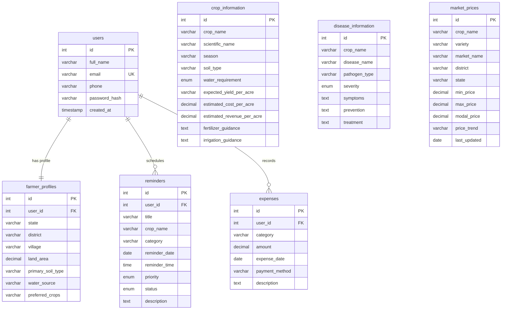

# FarmFusion Web – Smart Farming Advisory Platform

> **Web Development Mini Project**  
> **Course:** 3rd Semester B.Tech Computer Science and Engineering (AI & ML)  
> **Architecture:** Full-Stack MVC Web Application (HTML5 / CSS3 / Vanilla JS / Bootstrap 5 / Node.js / Express.js / MySQL)

---

## 🌾 Project Overview

**FarmFusion Web** is an individual full-stack agricultural advisory and farm management web application tailored to Indian agrarian contexts. The platform replaces fragmented paper records and informal agricultural guesswork with structured computational guidance, meteorological intelligence, task automation, and financial tracking.

### Core Modules
1. **Landing & Information Portal:** Educational overview, agricultural stats, benefits, and quick live meteorological glance.
2. **Farmer Authentication & Security:** Session-based authentication with bcrypt password hashing, form validation, and route protection.
3. **Farmer Dashboard:** Centralized operations hub displaying land holding metrics, local live weather, upcoming irrigation schedules, and expense summaries.
4. **Rule-Based Crop Advisory Engine:** Algorithmic crop matching based on soil type, available land area (acres), cropping season (Kharif, Rabi, Zaid), and irrigation capacity with revenue and input cost projections.
5. **Live Weather & Spraying Advisory:** Dynamic integration with the **Open-Meteo Weather API**, providing 7-day forecasts, precipitation probabilities, wind speed thresholds, and foliar spray safety guidance.
6. **Crop Disease & Pathology Directory:** Plant pathology knowledge base detailing visual symptoms, causal pathogens, favorable humidity/temperature triggers, cultural prevention, and certified remedies.
7. **Irrigation & Farming Task Reminders:** Complete CRUD task scheduler for irrigation stages, fertilizer split applications, pesticide spraying, and harvesting.
8. **Cultivation Expense Tracker & Visual Analytics:** Full CRUD financial ledger with category breakdowns, interactive Chart.js visualizations (Doughnut & Bar charts), and CSV export.
9. **Mandi Benchmark Rates:** Transparent market reference prices mapped across varieties, districts, and states with price trend indicators.
10. **Farmer Profile & Farm Settings:** Management of farmer identity, topography, land size, primary soil type, and water infrastructure.

---

## 🛠️ Technology Stack (Strict Academic Compliance)

| Layer | Technologies Used |
| :--- | :--- |
| **Frontend** | HTML5 Semantic Elements, CSS3 (Custom Agricultural Design System), Vanilla JavaScript (ES6+), Bootstrap 5.3, Bootstrap Icons 1.11, Chart.js 4.4 |
| **Backend** | Node.js (v20+), Express.js (v5) |
| **Database** | MySQL 8.0+ / MariaDB (XAMPP / WAMP / Standalone MySQL) via `mysql2/promise` |
| **Authentication** | `express-session` (cookie-based session state), `bcryptjs` (salt rounds: 10) |
| **External API** | Open-Meteo Meteorological Weather API (Free, live JSON endpoints) |
| **Data Exchange** | REST API, Fetch API, JSON payloads, Form URL-encoding |

*Note: In strict compliance with the prescribed syllabus, no third-party frontend frameworks (React, Angular, Vue) or alternate backends (Python Flask, FastAPI, Firebase) are used.*

---

## 📁 Project Structure

```text
farm-fusion-web/
├── config/
│   └── db.js                 # MySQL connection pool & resilient fallback engine
├── controllers/
│   ├── advisoryController.js # Rule-based crop matching & financial projections
│   ├── authController.js     # User registration, login, logout, session check
│   ├── diseaseController.js  # Plant pathology queries and symptom filters
│   ├── expenseController.js  # Farming expense CRUD and monthly analytics
│   ├── marketController.js   # Mandi price benchmark intelligence
│   ├── profileController.js  # Farmer profile and land holding settings
│   ├── reminderController.js # Irrigation and farm task CRUD
│   └── weatherController.js  # Open-Meteo API connection & spraying advisories
├── middleware/
│   ├── authMiddleware.js     # Session validation for protected routes & views
│   └── errorHandler.js       # Central error handling and 404 responses
├── public/                   # Static Frontend Client
│   ├── css/
│   │   └── style.css         # Nature-inspired responsive styling
│   ├── js/
│   │   ├── advisory.js       # Advisory form submission & result rendering
│   │   ├── auth.js           # Client-side form validation & AJAX auth
│   │   ├── dashboard.js      # Dashboard widgets, stats & live previews
│   │   ├── diseases.js       # Pathology search, filter & modal detail
│   │   ├── expenses.js       # Expense CRUD, Chart.js graphs, CSV export
│   │   ├── main.js           # Session status, mobile menu, toast alerts
│   │   ├── market.js         # Mandi table filtering and trend badges
│   │   ├── profile.js        # Profile settings form update
│   │   ├── reminders.js      # Task CRUD, filters & status toggles
│   │   └── weather.js        # Open-Meteo fetch & 7-day forecast cards
│   ├── 404.html              # Custom 404 error view
│   ├── advisory.html         # Crop advisory interface
│   ├── dashboard.html        # Farmer dashboard
│   ├── diseases.html         # Plant pathology directory
│   ├── expenses.html         # Expense tracker and analytics
│   ├── index.html            # Public landing page
│   ├── login.html            # Farmer login portal
│   ├── market.html           # Mandi market rates
│   ├── profile.html          # Farm profile settings
│   ├── register.html         # Farmer registration portal
│   └── reminders.html        # Task reminders interface
├── routes/
│   ├── advisoryRoutes.js     # /api/advisory endpoints
│   ├── authRoutes.js         # /api/auth endpoints
│   ├── diseaseRoutes.js      # /api/diseases endpoints
│   ├── expenseRoutes.js      # /api/expenses endpoints
│   ├── marketRoutes.js       # /api/market endpoints
│   ├── profileRoutes.js      # /api/profile endpoints
│   ├── reminderRoutes.js     # /api/reminders endpoints
│   └── weatherRoutes.js      # /api/weather endpoints
├── scripts/
│   └── init-db.js            # Automated MySQL database setup script
├── test/
│   ├── test-server.js        # Automated API test suite (17 endpoints)
│   └── test-weather.js       # Open-Meteo live API integration test
├── .env                      # Local environment configuration
├── .env.example              # Environment template
├── farmfusion.sql            # Full MySQL database schema + seed data
├── package.json              # Project manifest and dependencies
└── README.md                 # Complete project documentation
```

---

## ⚙️ Step-by-Step Setup & Installation Guide

### Prerequisites
- [Node.js](https://nodejs.org/) (Version 18.x or newer)
- [MySQL Server](https://dev.mysql.com/downloads/mysql/) or [XAMPP](https://www.apachefriends.org/) (with Apache & MySQL modules)

---

### Step 1: Install Dependencies
Open your command terminal (Command Prompt, PowerShell, or Bash) in the project directory:
```bash
npm install
```

---

### Step 2: Configure Environment Variables
Copy `.env.example` to create `.env` (or update existing `.env`):
```ini
# Server Configuration
PORT=3000
NODE_ENV=development
SESSION_SECRET=farmfusion_secret_session_key_2026

# MySQL Database Configuration
DB_HOST=localhost
DB_USER=root
DB_PASSWORD=
DB_NAME=farmfusion_db
DB_PORT=3306
```
> **Note for XAMPP users:** The default user is `root` with an empty password (`DB_PASSWORD=`).  
> **Note for Standalone MySQL users:** Enter your root password in `DB_PASSWORD`.

---

### Step 3: Create & Populate MySQL Database

You can initialize the database using **either** of the following methods:

#### Method A: Automated One-Command Script (Recommended)
Make sure your MySQL server is running (e.g., start MySQL in XAMPP Control Panel), then run:
```bash
npm run init-db
```
*This connects to MySQL, executes `farmfusion.sql`, creates the `farmfusion_db` database, creates all 7 tables, and populates comprehensive seed data.*

#### Method B: Manual Import via phpMyAdmin or MySQL CLI
1. Open [http://localhost/phpmyadmin](http://localhost/phpmyadmin).
2. Click on the **Import** tab.
3. Choose the file `farmfusion.sql` from the project root folder.
4. Click **Import** at the bottom.

---

### Step 4: Start the Express Server
```bash
# Standard Production Start
npm start

# Or Development Watch Mode (auto-reloads on edits)
npm run dev
```

You should see:
```text
===========================================================
🌾 FarmFusion Web – Smart Farming Advisory Platform
🚀 Server successfully launched on: http://localhost:3000
📡 Environment: development
===========================================================
[MySQL] ✓ Successfully connected to MySQL database: farmfusion_db on localhost:3306
```

---

### Step 5: Open in Your Browser
Open your browser and navigate to:
```text
http://localhost:3000
```

#### Demo Farmer Credentials for Evaluation:
- **Email:** `ramesh@farmfusion.in`
- **Password:** `farmer123`
*(A convenient "Auto-Fill" button is provided on `login.html` for rapid evaluation during viva demonstrations).*

---

## 🗄️ Database Schema & Relational Design

The relational database `farmfusion_db` comprises 7 tables with foreign keys and cascade rules:



---

## 📡 REST API Documentation

### 1. Authentication Endpoints (`/api/auth`)
| Method | Endpoint | Description | Request Body | Status Codes |
| :--- | :--- | :--- | :--- | :--- |
| `POST` | `/api/auth/register` | Registers farmer and creates initial farm profile | `{ full_name, email, phone, password, confirm_password, state, district, land_area, ... }` | 201 Created, 400 Bad Request, 409 Conflict |
| `POST` | `/api/auth/login` | Authenticates user and creates session | `{ email, password }` | 200 OK, 400 Bad Request, 401 Unauthorized |
| `POST` | `/api/auth/logout` | Destroys current session and clears cookie | None | 200 OK |
| `GET` | `/api/auth/me` | Returns logged-in user profile from session | None | 200 OK, 401 Unauthorized |

### 2. Farmer Profile Endpoints (`/api/profile`)
| Method | Endpoint | Description | Access |
| :--- | :--- | :--- | :--- |
| `GET` | `/api/profile` | Retrieves current farmer's profile | Authenticated |
| `PUT` | `/api/profile` | Updates farm location, soil type, acreage, water sources | Authenticated |

### 3. Irrigation Reminders Endpoints (`/api/reminders`)
| Method | Endpoint | Description | Access |
| :--- | :--- | :--- | :--- |
| `GET` | `/api/reminders` | Lists user's reminders with status/category filters | Authenticated |
| `POST` | `/api/reminders` | Adds a new task reminder | Authenticated |
| `PUT` | `/api/reminders/:id` | Updates an existing reminder | Authenticated |
| `PATCH`| `/api/reminders/:id/toggle` | Toggles status between Pending and Completed | Authenticated |
| `DELETE`| `/api/reminders/:id` | Permanently deletes a reminder | Authenticated |

### 4. Cultivation Expenses Endpoints (`/api/expenses`)
| Method | Endpoint | Description | Access |
| :--- | :--- | :--- | :--- |
| `GET` | `/api/expenses` | Lists expenses with category and date filters | Authenticated |
| `GET` | `/api/expenses/analytics` | Returns aggregated monthly and category metrics for Chart.js | Authenticated |
| `POST` | `/api/expenses` | Creates a new expense entry | Authenticated |
| `PUT` | `/api/expenses/:id` | Edits an expense entry | Authenticated |
| `DELETE`| `/api/expenses/:id` | Deletes an expense entry | Authenticated |

### 5. Crop Advisory Endpoints (`/api/advisory`)
| Method | Endpoint | Description |
| :--- | :--- | :--- |
| `POST` | `/api/advisory/recommend` | Rule-based engine scoring crops for given soil, season, and acreage |
| `GET` | `/api/advisory/crops` | Returns all crop profiles in database |

### 6. Crop Disease Directory (`/api/diseases`)
| Method | Endpoint | Description |
| :--- | :--- | :--- |
| `GET` | `/api/diseases` | Filter disease records by crop, severity, or keyword |
| `GET` | `/api/diseases/:id` | Full plant pathology details including treatment dosages |

### 7. Mandi Market Prices (`/api/market`)
| Method | Endpoint | Description |
| :--- | :--- | :--- |
| `GET` | `/api/market` | Search benchmark mandi rates by commodity or state |

### 8. Weather Integration (`/api/weather`)
| Method | Endpoint | Description |
| :--- | :--- | :--- |
| `GET` | `/api/weather/locations` | Preset agricultural belts (Punjab, Haryana, Maharashtra, etc.) |
| `GET` | `/api/weather/forecast` | Dynamic Open-Meteo 7-day forecast and pesticide spraying advisories |

---

## 💡 Web Development Syllabus Concepts Demonstrated

1. **HTML5 Semantic Structure:**
   - `<header>`, `<nav>`, `<main>`, `<aside>`, `<section>`, `<footer>`, `<figure>`.
   - Accessible form controls with `pattern`, `minlength`, `step`, and client validation attributes.
2. **CSS3 & Responsive Design:**
   - CSS Variables (`:root`) for structured theming.
   - Flexbox and CSS Grid layout for multi-device responsiveness (Desktop, Tablet, Mobile).
   - Clean transitions, custom hover states, and Bootstrap 5 offcanvas/collapsible sidebar.
3. **Vanilla JavaScript & DOM Manipulation:**
   - Event listeners (`click`, `submit`, `change`, `input`).
   - Debounced search inputs for performant live filtering.
   - Dynamic HTML rendering, template strings, and modal instantiation.
4. **Asynchronous Communication (AJAX & Fetch API):**
   - Asynchronous `async/await` network queries.
   - JSON serialization and parsing (`headers: { 'Content-Type': 'application/json' }`).
   - Graceful loading spinners and error alert banners.
5. **External API Integration:**
   - Live query to Open-Meteo meteorological endpoints.
   - WMO weather code mapping to agricultural iconography and spraying risk algorithms.
6. **Backend Architecture with Node.js & Express:**
   - Clean MVC separation (Routes, Controllers, Middleware, Config).
   - RESTful routing conventions (`GET`, `POST`, `PUT`, `PATCH`, `DELETE`).
   - Static asset serving via `express.static()`.
7. **Database Connectivity with MySQL:**
   - Connection pooling using `mysql2/promise`.
   - Parameterized queries with placeholder syntax (`?`) to neutralize SQL Injection vulnerabilities.
   - Foreign key constraints with `ON DELETE CASCADE`.
8. **Security & Session Management:**
   - Cookie-based session tracking with `express-session`.
   - Password encryption using cryptographic `bcryptjs` hashing.
   - Protection middleware intercepting unauthorized requests with HTTP 401 or login redirection.
9. **Data Visualization:**
   - Interactive Doughnut and Bar charts rendered via HTML5 `<canvas>` and Chart.js.
   - Client-side dynamic CSV generation for offline ledger export.

---

## 🎓 Viva Voce Preparation Guide (Questions & Answers)

### Q1: What architecture does this application follow?
> **Answer:** FarmFusion follows a full-stack **MVC (Model-View-Controller)** pattern. The MySQL database acts as the Model, the frontend HTML/CSS/Vanilla JS served statically acts as the View, and the Express.js routes and controllers act as the Controller processing business logic and REST requests.

### Q2: How is user authentication implemented and secured?
> **Answer:** When a farmer registers, their password is encrypted using `bcryptjs` with 10 salt rounds before being stored in MySQL. During login, `bcrypt.compare()` validates the password. Upon successful validation, a server-side session is created using `express-session` with a unique session ID stored in an `httpOnly` cookie (`connect.sid`). Protected API routes and dashboard views verify this session via the `requireAuth` middleware.

### Q3: How do you prevent SQL Injection attacks?
> **Answer:** All database operations in `config/db.js` and controllers use parameterized queries with `?` placeholders (e.g. `db.query('SELECT * FROM users WHERE email = ?', [email])`). The MySQL driver automatically sanitizes and escapes all user inputs before query execution.

### Q4: How is the rule-based Crop Advisory calculated?
> **Answer:** When a farmer inputs soil type, season, water availability, and land area, the controller retrieves crop profiles from the database and runs a weighted scoring algorithm:
> - **Season suitability:** +25 points for match; -30 for off-season.
> - **Soil compatibility:** +20 points for exact match; +10 for adaptable loam.
> - **Water sufficiency:** +20 points for adequate supply; -35 points penalty for high water demand under low water availability.
> The normalized score ranks crops into "Highly Recommended", "Recommended", or "Conditional", and multiplies acreage by crop yield and price benchmarks to project input costs and gross profits.

### Q5: How is Open-Meteo weather data integrated?
> **Answer:** The frontend or backend makes a GET request to the Open-Meteo REST API (`https://api.open-meteo.com/v1/forecast`) passing the farmer's latitude and longitude. The JSON response returns current temperature, relative humidity, wind speed, WMO weather codes, and 7-day daily forecasts. The frontend maps WMO codes to weather conditions and evaluates agricultural safety guidelines (e.g., advising against pesticide spraying if wind speeds exceed 20 km/h).

### Q6: What happens if MySQL is not running during demonstration?
> **Answer:** The database connection layer in `config/db.js` includes diagnostic error handling. If a live MySQL server is unreachable, it logs a clear warning and seamlessly routes into a resilient in-memory agricultural data store so that examiners and students can evaluate the full application UI and API without unexpected server crashes. Once MySQL is started and `npm run init-db` is executed, it automatically connects to live MySQL.

---

## 📜 Academic Declaration & Project Metadata
- **Project Name:** FarmFusion Web – Smart Farming Advisory Platform
- **Student Level:** 3rd Semester B.Tech Computer Science & Engineering (AI & ML)
- **Course Component:** Web Development Mini Project (Individual Project)
- **Year:** Academic Year 2026-27
